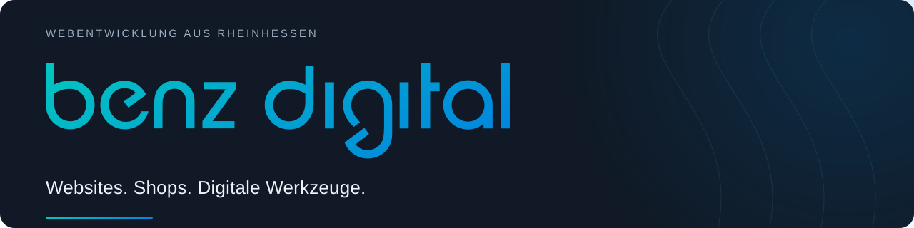

## Hallo, ich bin Stephan.

Mit **BenzDigital** entwickle und betreue ich Websites, Onlineshops und digitale Werkzeuge. Ich arbeite aus Rheinhessen und begleite Projekte von der ersten Idee bis zum laufenden Betrieb.

### Meine Schwerpunkte

- **Websites & Shops** – WordPress, WooCommerce und individuelle Themes.
- **Eigene Erweiterungen** – Plugins, Schnittstellen und Anwendungen für konkrete Aufgaben.
- **Betreuung & Weiterentwicklung** – Wartung, Performance und technische Abläufe.

### Mein Werkzeugkasten

`WordPress` · `WooCommerce` · `PHP` · `JavaScript` · `HTML & CSS` · `Python`

---

Die meisten Kundenprojekte liegen in privaten Repositories. Referenzen und mehr über meine Arbeit findest du auf meiner Website.

**[Website & Kontakt →](https://www.benzdigital.de)**
